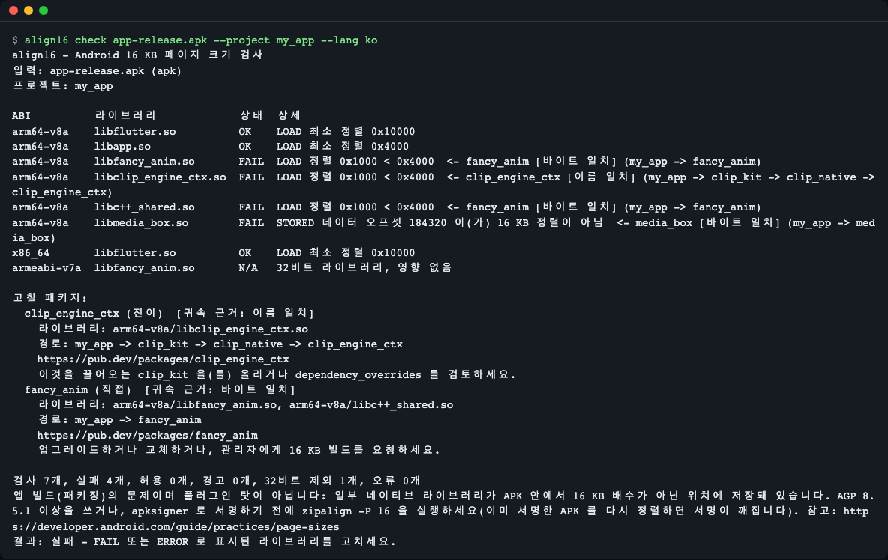
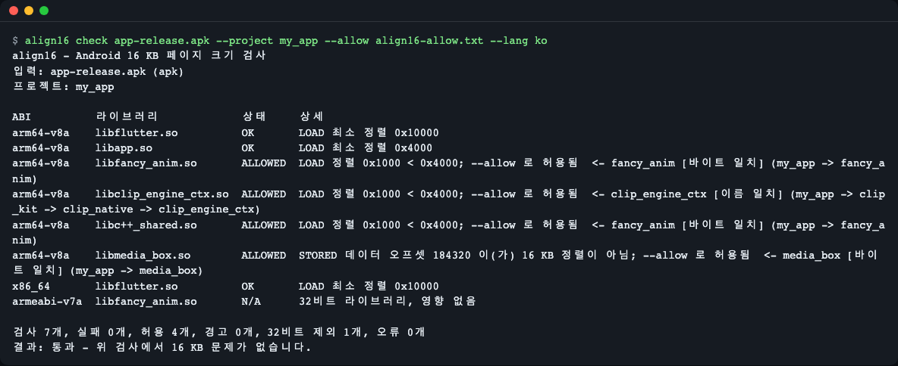
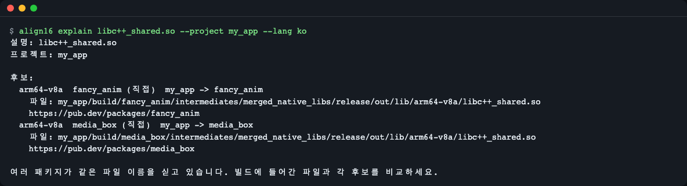
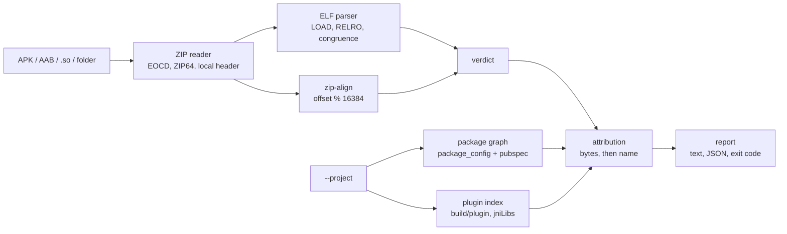

# align16

[English](README.md) | **한국어**

APK·AAB 안의 어떤 `.so` 가 안드로이드 16 KB 메모리 페이지를 지원하지 않는지, 그리고 그 파일을 Flutter 앱에 들여온 pub 패키지(와 의존 경로)가 무엇인지 알려 주는 도구입니다. 순수 Dart 라서 `readelf`, `zipalign`, Android SDK 가 필요 없습니다.


*`align16 sample` 이 만든 합성 샘플 앱에 `align16 check` 를 돌린 화면입니다. FAIL 줄마다 원인 패키지와 의존 경로가 붙습니다.*

## 이런 분께
- Android 15+(API 35+)를 대상으로 Flutter 앱을 만드는데 Google Play 가 "16 KB 페이지 크기 미지원"이라고 알려 온 경우
- 다른 도구가 `libsomething.so` 가 4 KB 정렬이라고만 알려 주고, 어느 플러그인이 싣고 있는지는 모르는 경우
- 릴리스 빌드에서 정렬이 다시 깨지면 실패하는 CI 단계가 필요하고, 업스트림이 아직 못 고친 예외는 짧은 허용 목록으로 두고 싶은 경우

배경: 2027-02-01부터 Google Play 는 Android 15+ 를 대상으로 하는 앱이 16 KB 페이지 크기를 지원하길 요구합니다([Android 문서](https://developer.android.com/guide/practices/page-sizes), 2026-11-18 확인). Flutter 엔진 라이브러리는 이미 대응돼 있고, 보통 걸리는 것은 옛 NDK 로 빌드된 서드파티 플러그인·SDK 입니다.

## 설치

[Dart SDK](https://dart.dev/get-dart)가 필요합니다(Flutter 에 들어 있음). 최소 리눅스 이미지에서는 `git`, `ca-certificates` 도 필요합니다.

```bash
# pub.dev 에서 (게시된 뒤)
dart pub global activate align16

# 또는 GitHub 에서 바로
dart pub global activate --source git https://github.com/LeeGyeongPil/align16

# 또는 clone 해서 설치 없이 실행
git clone https://github.com/LeeGyeongPil/align16 && cd align16
dart pub get
dart run bin/align16.dart --version
```

pub 캐시의 `bin` 폴더가 `PATH` 에 있어야 합니다(`dart pub global activate` 가 정확한 안내를 출력합니다).

## 빠르게 시작하기

빌드한 앱이 없어도 됩니다. `align16 sample` 은 아주 작은 합성 APK·AAB, 가짜 Flutter 프로젝트, 허용 목록(`align16-allow.txt`)을 폴더에 만듭니다. "연습용 합성 샘플 … 실제 빌드가 아닙니다. 아래 검사는 진짜로 실행됩니다"라고 알리고, 만든 파일마다 `만든 위치:` 줄을 출력한 뒤 검사기를 한 번 돌립니다. 파일은 연습용 샘플이지 실제 빌드가 아니지만 판정은 진짜입니다. 이어서 샘플 APK 를 직접 검사해 봅니다.

```bash
align16 sample --out ./align16-sample
cd align16-sample
align16 check app-release.apk --project my_app
```

이 문서의 출력은 모두 한국어 화면으로 만든 것입니다. 명령은 영어 README 와 같습니다. 한국어 로케일이 아니라면 `--lang ko` 를 덧붙이거나 `ALIGN16_LANG=ko` 를 지정하세요.

```text
align16 - Android 16 KB 페이지 크기 검사
입력: app-release.apk (apk)
프로젝트: my_app

ABI          라이브러리             상태  상세
arm64-v8a    libflutter.so          OK    LOAD 최소 정렬 0x10000
arm64-v8a    libapp.so              OK    LOAD 최소 정렬 0x4000
arm64-v8a    libfancy_anim.so       FAIL  LOAD 정렬 0x1000 < 0x4000  <- fancy_anim [바이트 일치] (my_app -> fancy_anim)
arm64-v8a    libclip_engine_ctx.so  FAIL  LOAD 정렬 0x1000 < 0x4000  <- clip_engine_ctx [이름 일치] (my_app -> clip_kit -> clip_native -> clip_engine_ctx)
arm64-v8a    libc++_shared.so       FAIL  LOAD 정렬 0x1000 < 0x4000  <- fancy_anim [바이트 일치] (my_app -> fancy_anim)
arm64-v8a    libmedia_box.so        FAIL  STORED 데이터 오프셋 184320 이(가) 16 KB 정렬이 아님  <- media_box [바이트 일치] (my_app -> media_box)
x86_64       libflutter.so          OK    LOAD 최소 정렬 0x10000
armeabi-v7a  libfancy_anim.so       N/A   32비트 라이브러리, 영향 없음

고칠 패키지:
  clip_engine_ctx (전이)  [귀속 근거: 이름 일치]
    라이브러리: arm64-v8a/libclip_engine_ctx.so
    경로: my_app -> clip_kit -> clip_native -> clip_engine_ctx
    https://pub.dev/packages/clip_engine_ctx
    이것을 끌어오는 clip_kit 을(를) 올리거나 dependency_overrides 를 검토하세요.
  fancy_anim (직접)  [귀속 근거: 바이트 일치]
    라이브러리: arm64-v8a/libfancy_anim.so, arm64-v8a/libc++_shared.so
    경로: my_app -> fancy_anim
    https://pub.dev/packages/fancy_anim
    업그레이드하거나 교체하거나, 관리자에게 16 KB 빌드를 요청하세요.

검사 7개, 실패 4개, 허용 0개, 경고 0개, 32비트 제외 1개, 오류 0개
앱 빌드(패키징)의 문제이며 플러그인 탓이 아닙니다: 일부 네이티브 라이브러리가 APK 안에서 16 KB 배수가 아닌 위치에 저장돼 있습니다. AGP 8.5.1 이상을 쓰거나, apksigner 로 서명하기 전에 zipalign -P 16 을 실행하세요(이미 서명한 APK 를 다시 정렬하면 서명이 깨집니다). 참고: https://developer.android.com/guide/practices/page-sizes
결과: 실패 - FAIL 또는 ERROR 로 표시된 라이브러리를 고치세요.
```

(샘플의 패키지 이름은 지어낸 것입니다.) `libmedia_box.so` 는 FAIL 줄이지만 `media_box` 는 "고칠 패키지"에 없습니다. 파일 자체는 문제가 없고, 내 앱 빌드가 그 파일을 담은 방식이 문제이기 때문입니다([찾은 문제 고치기](#찾은-문제-고치기) 참고).

읽는 법:
- **상태**: `OK`, `FAIL`, `WARN`, `N/A`(32비트 라이브러리는 영향 없음), `ALLOWED`(허용 목록에 있음), `ERROR`(올바른 ELF 가 아님).
- **`<- 패키지 [바이트 일치]`**: 라이브러리 뒤에 있는 pub 패키지이고, 괄호 안 낱말은 얼마나 확실한지 알려 줍니다. 표와 "고칠 패키지"(`[귀속 근거: …]`)에서 같은 낱말을 씁니다.
  - `바이트 일치`: APK 안 바이트가 그 패키지가 만들거나 동봉한 파일과 완전히 같습니다.
  - `이름 일치`: 그 이름의 라이브러리를 가진 패키지가 하나뿐이지만, 바이트는 비교하지 못했거나 다릅니다.
  - `후보 여러 개: a, b`: 출처일 수 있는 패키지가 여럿이라 추측하지 않고 후보를 전부 나열합니다.
- **`(my_app -> clip_kit -> ...)`**: 내 앱에서 그 패키지까지의 가장 짧은 의존 경로. `직접`은 내 `pubspec.yaml` 에 있는 패키지, `전이`는 다른 패키지를 통해 들어온 것이라 보통 그 위의 직접 패키지를 올리는 게 해법입니다.
- **고칠 패키지**: 그 패키지 자체의 라이브러리가 ELF 검사에서 실패한 경우만 나옵니다. zip 정렬 실패는 플러그인이 아니라 내 앱 빌드에서 생기므로 패키지 대신 패키징 안내 한 줄로 알려 줍니다.

실제 앱에서는:

```bash
flutter build apk --release
align16 check build/app/outputs/flutter-apk/app-release.apk --project .
```

종료 코드: `0` 통과, `1` FAIL 또는 ERROR 있음, `2` 사용법·입력 오류(없는 파일, ZIP·ELF 가 아님, `.so` 가 없는 폴더, `--project` 에 `pubspec.yaml` 없음).

## 사용법

| 명령·옵션 | 하는 일 | 예 |
|---|---|---|
| `check <apk\|aab\|so\|dir>` | APK, AAB(모든 모듈), `.so` 하나, 폴더의 64비트 `.so` 를 전부 검사 | `align16 check app-release.aab` |
| `--project <dir>` | Flutter 앱 폴더. 실패를 pub 패키지까지 추적 | `--project .` |
| `--abi <list>` | 해당 ABI 만(기본: 찾은 전부) | `--abi arm64-v8a,x86_64` |
| `--allow <file>` | 허용 목록. 한 줄에 `libname.so` 또는 `<abi>/libname.so`, `#` 주석 | `--allow align16-allow.txt` |
| `--strict` | 합동 경고를 실패로 처리 | `--strict` |
| `--format text\|json\|markdown` / `--json` | 출력 형식. JSON 은 `schema: 1` 이며 언어와 무관 | `--format markdown` |
| `--baseline <json>` | 이전 `--json` 보고서에 없는 실패만 실패로 처리 | `--baseline align16-baseline.json` |
| `--gradle-cache <dir>` | 풀린 Maven AAR 의 라이브러리도 연결(`explain` 도 가능). 없는 폴더면 종료 코드 2 | `--gradle-cache ~/.gradle/caches` |
| `--lang en\|ko`, `--no-color` | 출력 언어, 색 끄기 | `--lang ko` |
| `explain <libname.so> --project <dir>` | 빌드 산출물 없이 이 라이브러리를 싣고 있을 수 있는 패키지 | `align16 explain libc++_shared.so --project .` |
| `sample [--out <dir>]` | 연습용 샘플(빠르게 시작하기 참고) | `align16 sample` |

### 알려진 예외: 허용 목록

지금 당장 고칠 수 없는 실패(업스트림 수정이 아직 안 나옴)는 허용 목록에 적어 두면, 화면에는 계속 보이지만 실행을 실패시키지 않습니다. `align16 sample` 이 샘플 폴더에 이미 하나 만들어 두었습니다.

```bash
cat align16-allow.txt
```

```text
# 연습용 샘플의 align16 허용 목록입니다. 여기 적은 라이브러리는
# ALLOWED 로 표시되고 실행을 실패시키지 않습니다(알려진 잔여 문제).
# 한 줄에 libname.so 또는 <abi>/libname.so 하나씩 적습니다.
libfancy_anim.so
libclip_engine_ctx.so
arm64-v8a/libc++_shared.so
libmedia_box.so
```

(주석 줄은 샘플을 만들 때 고른 언어로 쓰입니다. 영어 화면이면 영어 주석입니다.) 같은 검사를 허용 목록과 함께 돌립니다(여전히 `align16-sample` 안에서).

```bash
align16 check app-release.apk --project my_app --allow align16-allow.txt
```

```text
align16 - Android 16 KB 페이지 크기 검사
입력: app-release.apk (apk)
프로젝트: my_app

ABI          라이브러리             상태     상세
arm64-v8a    libflutter.so          OK       LOAD 최소 정렬 0x10000
arm64-v8a    libapp.so              OK       LOAD 최소 정렬 0x4000
arm64-v8a    libfancy_anim.so       ALLOWED  LOAD 정렬 0x1000 < 0x4000; --allow 로 허용됨  <- fancy_anim [바이트 일치] (my_app -> fancy_anim)
arm64-v8a    libclip_engine_ctx.so  ALLOWED  LOAD 정렬 0x1000 < 0x4000; --allow 로 허용됨  <- clip_engine_ctx [이름 일치] (my_app -> clip_kit -> clip_native -> clip_engine_ctx)
arm64-v8a    libc++_shared.so       ALLOWED  LOAD 정렬 0x1000 < 0x4000; --allow 로 허용됨  <- fancy_anim [바이트 일치] (my_app -> fancy_anim)
arm64-v8a    libmedia_box.so        ALLOWED  STORED 데이터 오프셋 184320 이(가) 16 KB 정렬이 아님; --allow 로 허용됨  <- media_box [바이트 일치] (my_app -> media_box)
x86_64       libflutter.so          OK       LOAD 최소 정렬 0x10000
armeabi-v7a  libfancy_anim.so       N/A      32비트 라이브러리, 영향 없음

검사 7개, 실패 0개, 허용 4개, 경고 0개, 32비트 제외 1개, 오류 0개
결과: 통과 - 위 검사에서 16 KB 문제가 없습니다.
```


*허용한 항목도 `ALLOWED` 로 계속 보이므로 잊히지 않습니다. 종료 코드는 0 입니다.*

내 앱에서는 `pubspec.yaml` 옆에 `align16-allow.txt` 를 만들고 한 줄에 `libname.so`(또는 `<abi>/libname.so`)를 하나씩 적습니다. 패키지가 고쳐지면 그 줄을 지우세요.

### 같은 라이브러리를 여러 패키지가 싣는 경우

`libc++_shared.so` 는 여러 플러그인이 함께 싣는 일이 많습니다. `align16 explain` 은 누가 싣고 있을 수 있는지 나열하고, `check` 는 바이트가 같은 쪽을 골라(`바이트 일치`) 알려 주거나 후보를 전부 나열합니다(`후보 여러 개`).

```bash
align16 explain libc++_shared.so --project my_app
```

```text
설명: libc++_shared.so
프로젝트: my_app

후보:
  arm64-v8a  fancy_anim (직접)  my_app -> fancy_anim
    파일: my_app/build/fancy_anim/intermediates/merged_native_libs/release/out/lib/arm64-v8a/libc++_shared.so
    https://pub.dev/packages/fancy_anim
  arm64-v8a  media_box (직접)  my_app -> media_box
    파일: my_app/build/media_box/intermediates/merged_native_libs/release/out/lib/arm64-v8a/libc++_shared.so
    https://pub.dev/packages/media_box

여러 패키지가 같은 파일 이름을 싣고 있습니다. 빌드에 들어간 파일과 각 후보를 비교하세요.
```


*이 이름의 라이브러리를 두 패키지가 싣고 있습니다. 둘 다 알려 주고 추측하지 않습니다. `파일:` 경로는 명령을 실행한 폴더 기준입니다.*

### CI

필요한 줄을 고르세요. 세 줄은 한 스크립트가 아니라 서로 다른 선택지입니다. 어떤 형식이든 실패한 라이브러리가 있으면 종료 코드 1 이므로, 실패해도 스크립트를 멈추지 않을 줄(예: JSON 저장만)에는 `|| true` 를 붙입니다.

```bash
align16 check app-release.apk --project . --json > align16.json || true   # 도구 연동용으로 저장
align16 check app-release.apk --project . --format markdown >> "$GITHUB_STEP_SUMMARY"
align16 check app-release.apk --project . --baseline align16-baseline.json
```

baseline 줄은 `align16-baseline.json`(전에 `--json` 으로 저장한 보고서)에 없는 실패만 실패로 셉니다. 이미 알던 실패는 `집계 제외: 기준선(baseline)에 있던 알려진 실패 N개.` 줄로 알려 줍니다.

워크플로 전체 예시는 [docs/github-actions.md](docs/github-actions.md), JSON 필드는 [docs/json-schema.md](docs/json-schema.md)(둘 다 영어). CI 에서도 `build/` 폴더를 남겨 두세요. 어느 패키지가 만든 라이브러리인지 `build/<plugin>/intermediates` 를 보고 판단합니다.

### 검사 항목, 쉬운 설명

네이티브 라이브러리(`.so`)를 책이라고 생각해 보세요. 메모리 적재기는 이 책을 "페이지" 단위로 메모리에 복사합니다. 예전 기기는 페이지가 4 KB 이고, Android 15+ 기기는 16 KB 일 수 있습니다. 적재기는 페이지 전체만 복사할 수 있어서, 장(章)이 16 KB 눈금이 아닌 4 KB 눈금에서 시작하는 책은 16 KB 기기에 올릴 수 없고 앱이 시작하자마자 죽습니다. [Android 16 KB 가이드](https://developer.android.com/guide/practices/page-sizes)(2026-11-18 확인)의 규칙을 64비트 라이브러리마다 적용합니다.

- `load-align`: ELF 파일은 메모리에 올릴 덩어리를 `PT_LOAD` 세그먼트로 적고, 각 세그먼트가 원하는 정렬(`p_align`)을 밝힙니다. `p_align` 은 `0x4000`(16 KB) 이상이어야 합니다. `0x1000` 이면 4 KB 페이지용으로 빌드됐다는 뜻입니다.
- `relro`: `PT_GNU_RELRO` 는 시작 후 읽기 전용이 되는 영역입니다. 끝이 16 KB 경계(또는 속한 LOAD 세그먼트의 끝)여야 적재기가 페이지 단위로 보호할 수 있습니다.
- `congruence`(합동): 세그먼트는 파일 안 위치(`p_offset`)와 메모리 안 위치(`p_vaddr`)가 있고, 둘을 `p_align` 으로 나눈 나머지가 같아야 합니다. `p_align` 숫자만 키워 고친 파일은 겉보기만 멀쩡하고 이 규칙에서 걸립니다. 경고이고, `--strict` 면 실패입니다.
- `zip-align`: 라이브러리가 아니라 APK 에 대한 검사입니다. 저장(비압축)된 라이브러리는 APK 에서 바로 메모리에 올라가므로 ZIP 안에서 16 KB 배수 위치에서 시작해야 합니다. 압축된 항목은 설치 때 풀리므로 `n/a` 입니다. AAB 는 대신 `BundleConfig.pb` 의 정렬 설정을 읽습니다(`PAGE_ALIGNMENT_4K` 실패, 16K·64K 통과).

앞의 세 가지는 라이브러리 자체의 성질이라 그것을 싣고 온 패키지의 책임입니다. `zip-align` 은 내 앱을 어떻게 패키징했는가로 정해지므로 앱 빌드 문제로 따로 알려 줍니다.

### 찾은 문제 고치기

어떤 검사가 실패했는지에 따라 다릅니다([Android 16 KB 가이드](https://developer.android.com/guide/practices/page-sizes) 기준, 2026-11-18 확인).

1. **패키지의 ELF 실패**(`load-align`, `relro`, `congruence`): `경로:` 줄을 보세요.
   - 경로 위의 직접 패키지를 올립니다(전이 패키지라면 내 앱 바로 다음 패키지). 변경 기록에서 16 KB 지원 여부를 확인하세요.
   - 고친 버전이 이미 나왔는데 중간 패키지가 옛 버전을 고정하고 있다면 `pubspec.yaml` 의 `dependency_overrides:` 로 강제한 뒤 `flutter pub get` 하고 다시 빌드합니다.
   - 아니면 실패한 줄을 붙여 업스트림에 이슈를 남기고, 그동안 CI 는 `--allow`("알려진 예외" 참고)로 통과시킵니다.
2. **내 네이티브 코드의 ELF 실패**: Android NDK r28 이상으로 다시 빌드하면 기본으로 16 KB 정렬됩니다. NDK r27 이면 링커 옵션 `-Wl,-z,max-page-size=16384`를 추가합니다.
3. **`zip-align` 만 실패**("패키징" 안내 줄만 나오고 탓할 패키지가 없음): Android Gradle Plugin(AGP) 8.5.1 이상으로 빌드하면 저장된 라이브러리를 16 KB 로 정렬하고, 아니면 `apksigner` 로 서명하기 전에 `zipalign -P 16` 을 실행합니다(이미 서명한 APK 를 다시 정렬하면 서명이 깨집니다. [zipalign 문서](https://developer.android.com/tools/zipalign), 2026-11-18 확인). AAB 는 번들 설정의 페이지 정렬을 4K 로 두지 마세요. 16K 나 64K 이면 `check` 가 그 설정을 읽었다는 참고 줄을 출력합니다.
4. 새 빌드에 `align16 check` 를 다시 돌립니다. FAIL·ERROR 가 남지 않으면 통과합니다.

## 설정

| 설정 | 의미 |
|---|---|
| `--lang en\|ko` | 화면 언어. 순서: `--lang`, `ALIGN16_LANG`, `LC_ALL`, `LC_MESSAGES`, `LANG`. `ko` 로 시작하지 않으면 영어. JSON 출력은 언어와 무관 |
| `ALIGN16_LANG` | `en` 또는 `ko`. 예: `ALIGN16_LANG=ko align16 sample` |
| `NO_COLOR` | 아무 값이나 주면 색을 끕니다 |
| `ALIGN16_FLUTTER_ROOT` | 선택, 테스트 전용: 로컬 Flutter SDK 위치(실제 엔진 라이브러리 확인용) |

API 키도 네트워크도 쓰지 않습니다.

## 동작 원리



1. ZIP 리더가 중앙 디렉터리(ZIP64 포함)를 찾고, 각 항목의 데이터 위치를 로컬 헤더로 계산하며 필요한 바이트만 읽습니다.
2. ELF 파서가 64비트 라이브러리의 프로그램 헤더(`PT_LOAD`, `PT_GNU_RELRO`)를 읽습니다. 32비트는 `N/A`.
3. 판정 단계가 네 가지 검사를 합치고 `--allow`, `--abi`, `--strict` 를 적용합니다.
4. 패키지 그래프는 `pubspec.yaml`, `.dart_tool/package_config.json`, 각 패키지의 `pubspec.yaml` 로 만들고, 너비 우선 탐색으로 내 앱에서 각 패키지까지의 최단 경로를 구합니다.
5. 플러그인 색인은 `build/<plugin>/intermediates/**/<abi>/` 와 플러그인 `jniLibs` 폴더의 라이브러리를 모읍니다. 귀속은 바이트를 먼저(`바이트 일치`), 다음에 이름을(`이름 일치`) 비교하고, 결정할 수 없으면 추측하지 않고 `후보 여러 개` 또는 `귀속 못 함` 으로 둡니다. JSON 에서는 같은 값이 `exact`, `name`, `ambiguous`, `none` 입니다.

## 언제 쓰나

- 잘 맞는 경우: 어느 Flutter 패키지를 올리거나 바꿔야 하는지 알고 싶을 때, 의존성 없이 APK·AAB 의 16 KB 정렬을 CI 에서 확인하고 싶을 때.
- 진단만 합니다. 라이브러리를 고치거나 다시 링크하지 않습니다(`p_align` 만 바꾸면 겉보기만 맞고 실제로는 틀린 파일이 되는데, 합동 검사가 그런 파일을 표시합니다).
- 다른 도구: 화면으로 보려면 Android Studio 의 APK Analyzer·린트([문서](https://developer.android.com/guide/practices/page-sizes)), 공식 스크립트와 zip 정렬 도구는 같은 페이지의 `check_elf_alignment.sh`, `zipalign`.

한계: 직접 `flutter build` 를 실행하지 않고 산출물만 읽습니다. Maven AAR 에서 온 라이브러리는 `--gradle-cache` 와 플러그인 `android/build.gradle(.kts)` 에 선언된 아티팩트가 맞을 때만 귀속됩니다. iOS·데스크톱 바이너리는 대상이 아닙니다. 출력을 `head` 처럼 일찍 닫는 명령으로 파이프하면 Dart 의 broken-pipe 오류가 출력됩니다.

## 자주 겪는 문제

| 증상 | 원인 | 해결 |
|---|---|---|
| `align16: command not found` | pub 캐시 `bin` 폴더가 `PATH` 에 없음 | `PATH` 에 추가(activate 명령이 경로를 알려 줌), 또는 clone 에서 `dart run bin/align16.dart` |
| FAIL 줄에 `<-` 패키지가 없음 | `--project` 를 안 줬거나 `build/` 를 지움 | `--project .` 를 주고 `build/` 를 남김. Maven 라이브러리면 `--gradle-cache` |
| 줄 끝이 `후보 여러 개: …` | 여러 패키지가 같은 이름의 파일을 싣고 바이트가 일치하는 곳이 없음 | 나열된 후보를 보거나 `align16 explain` 사용 |
| 종료 코드 2 와 `Gradle 캐시 폴더를 찾을 수 없습니다` | `--gradle-cache` 오타 | 앱을 빌드한 머신의 Gradle caches 폴더를 지정(예: `~/.gradle/caches`) |
| 종료 코드 2 와 `허용 목록을 읽을 수 없습니다` | `--allow` 파일이 없음(그 파일이 있는 폴더에서 실행하지 않음) | 경로를 확인하세요. 샘플은 `align16 sample` 이 `align16-allow.txt` 를 만든 `align16-sample` 안에서 실행합니다 |
| 종료 코드 2 와 `입력을 찾을 수 없습니다: …` | 경로가 틀림 | `.apk`·`.aab` 경로 확인 |
| 종료 코드 2 와 ZIP·ELF 가 아니라는 메시지 | 다른 종류의 파일(텍스트, 이름만 바꾼 압축 파일 등) | `.apk`, `.aab`, `.so` 또는 폴더를 넘기세요 |
| 종료 코드 2 와 `네이티브 라이브러리(.so)를 찾지 못했습니다` | `.so` 가 하나도 없는 폴더(빌드 산출물 경로가 틀림) | `.apk`·`.aab` 를 넘기거나 `lib/<abi>/*.so` 가 있는 풀린 폴더를 넘기세요 |
| `zip-align` 검사만 실패 | APK 안 저장된 `.so` 가 16 KB 위치에 있지 않음 | AGP 8.5.1+ 또는 `zipalign -P 16` 사용, [찾은 문제 고치기](#찾은-문제-고치기) 참고 |

## 개발·기여

```bash
dart pub get
dart analyze --fatal-infos
dart test
```

테스트 125개 통과, 1개 건너뜀(`ALIGN16_FLUTTER_ROOT` 필요), Dart SDK 3.8.1 에서 확인했습니다. 버그·제안은 이슈로 남겨 주세요. 변경 기록은 [CHANGELOG.md](CHANGELOG.md).

## 라이선스

MIT. 의존성: [`args`](https://pub.dev/packages/args)(BSD-3-Clause), [`yaml`](https://pub.dev/packages/yaml)(MIT).
