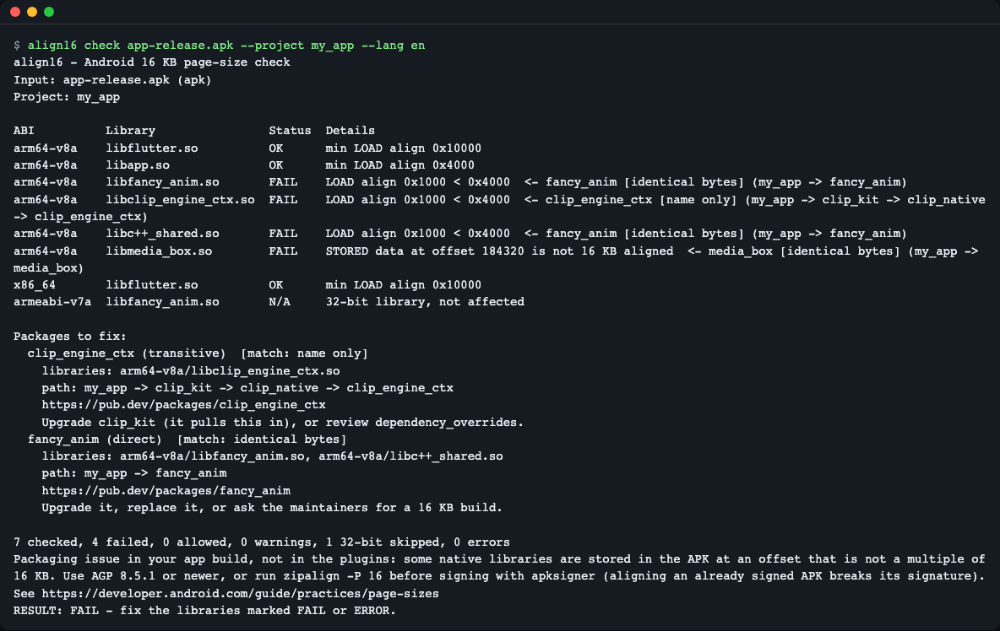
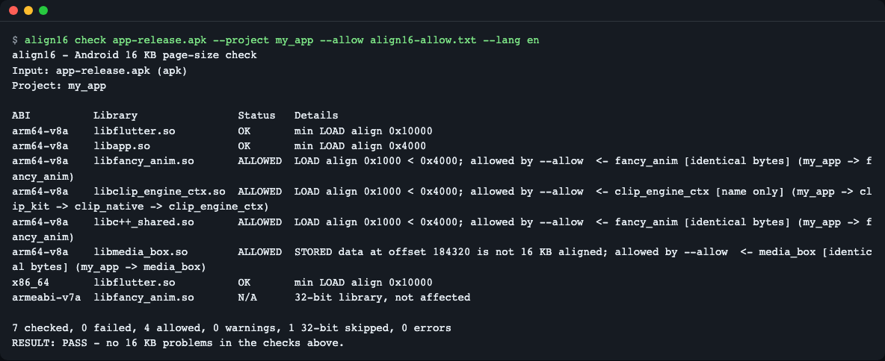
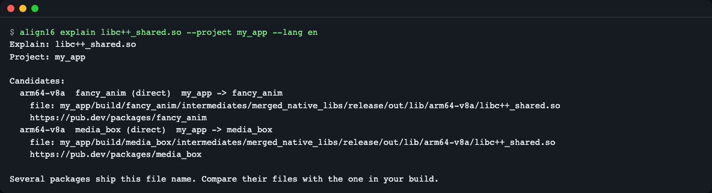
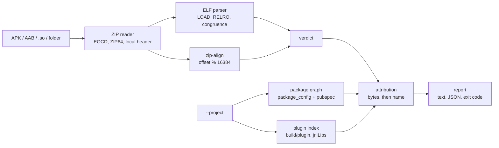

# align16

**English** | [한국어](README.ko.md)

Find out which `.so` files in your APK or AAB are not ready for Android's 16 KB memory pages, and which pub package (and dependency path) brought each one into your Flutter app. Pure Dart, no `readelf`, `zipalign` or Android SDK needed.


*`align16 check` on the synthetic sample app from `align16 sample`. Every FAIL row ends with the package and dependency path behind it.*

## Who it is for
- You build Flutter apps for Android 15+ (API 35+) and Google Play says the app does not support 16 KB page sizes.
- A tool told you `libsomething.so` is 4 KB aligned, but you do not know which plugin ships it.
- You want a CI step that fails when a release build regresses, with a short allow list for known upstream leftovers.

Background: starting 2027-02-01 Google Play requires apps that target Android 15+ to support 16 KB page sizes ([Android docs](https://developer.android.com/guide/practices/page-sizes), checked 2026-11-18). The Flutter engine library is already built for it; the usual culprits are third-party plugins and SDKs built with older NDKs.

## Install

Requires the [Dart SDK](https://dart.dev/get-dart) (it comes with Flutter). On minimal Linux images you also need `git` and `ca-certificates`.

```bash
# from pub.dev (after the package is published there)
dart pub global activate align16

# or straight from GitHub
dart pub global activate --source git https://github.com/LeeGyeongPil/align16

# or from a clone, without installing
git clone https://github.com/LeeGyeongPil/align16 && cd align16
dart pub get
dart run bin/align16.dart --version
```

Make sure the pub cache `bin` folder is on your `PATH` (`dart pub global activate` prints the exact hint).

## Quick start

No build handy? `align16 sample` writes a tiny synthetic APK, AAB, a fake Flutter project and an allow list (`align16-allow.txt`) into a folder. It prints "This is a synthetic practice sample ... not a real build. The checks below are real.", one `Created:` line per file, and then runs the checker once. The files are a practice sample, not a real build, but the verdicts are real. Then check the sample APK yourself:

```bash
align16 sample --out ./align16-sample
cd align16-sample
align16 check app-release.apk --project my_app
```

```text
align16 - Android 16 KB page-size check
Input: app-release.apk (apk)
Project: my_app

ABI          Library                Status  Details
arm64-v8a    libflutter.so          OK      min LOAD align 0x10000
arm64-v8a    libapp.so              OK      min LOAD align 0x4000
arm64-v8a    libfancy_anim.so       FAIL    LOAD align 0x1000 < 0x4000  <- fancy_anim [identical bytes] (my_app -> fancy_anim)
arm64-v8a    libclip_engine_ctx.so  FAIL    LOAD align 0x1000 < 0x4000  <- clip_engine_ctx [name only] (my_app -> clip_kit -> clip_native -> clip_engine_ctx)
arm64-v8a    libc++_shared.so       FAIL    LOAD align 0x1000 < 0x4000  <- fancy_anim [identical bytes] (my_app -> fancy_anim)
arm64-v8a    libmedia_box.so        FAIL    STORED data at offset 184320 is not 16 KB aligned  <- media_box [identical bytes] (my_app -> media_box)
x86_64       libflutter.so          OK      min LOAD align 0x10000
armeabi-v7a  libfancy_anim.so       N/A     32-bit library, not affected

Packages to fix:
  clip_engine_ctx (transitive)  [match: name only]
    libraries: arm64-v8a/libclip_engine_ctx.so
    path: my_app -> clip_kit -> clip_native -> clip_engine_ctx
    https://pub.dev/packages/clip_engine_ctx
    Upgrade clip_kit (it pulls this in), or review dependency_overrides.
  fancy_anim (direct)  [match: identical bytes]
    libraries: arm64-v8a/libfancy_anim.so, arm64-v8a/libc++_shared.so
    path: my_app -> fancy_anim
    https://pub.dev/packages/fancy_anim
    Upgrade it, replace it, or ask the maintainers for a 16 KB build.

7 checked, 4 failed, 0 allowed, 0 warnings, 1 32-bit skipped, 0 errors
Packaging issue in your app build, not in the plugins: some native libraries are stored in the APK at an offset that is not a multiple of 16 KB. Use AGP 8.5.1 or newer, or run zipalign -P 16 before signing with apksigner (aligning an already signed APK breaks its signature). See https://developer.android.com/guide/practices/page-sizes
RESULT: FAIL - fix the libraries marked FAIL or ERROR.
```

(The package names in the sample are made up.) Note that `libmedia_box.so` is a FAIL row but `media_box` is not under "Packages to fix": its file itself is fine, the problem is how your app build packed it (see [Fixing what you find](#fixing-what-you-find)).

How to read it:
- **Status** is `OK`, `FAIL`, `WARN`, `N/A` (32-bit libraries are not affected), `ALLOWED` (listed in your allow file) or `ERROR` (not a valid ELF file).
- **`<- package [identical bytes]`** names the pub package behind a library, and the word in brackets says how sure the match is. The same word is used in the table and under "Packages to fix":
  - `identical bytes`: the bytes in your APK are identical to a file that package builds or bundles.
  - `name only`: only one package has a library with that name, but the bytes were not compared or differ.
  - `several candidates: a, b`: more than one package could be the source, so every candidate is listed instead of a guess.
- **`(my_app -> clip_kit -> ...)`** is the shortest dependency path from your app. `direct` packages are in your `pubspec.yaml`; `transitive` ones come in through another package, so the fix is usually to upgrade the direct package above it.
- **Packages to fix** only lists packages whose own library failed an ELF check. Zip-alignment failures are reported once as a packaging note instead, because they come from your app build, not from the plugin.

On a real app:

```bash
flutter build apk --release
align16 check build/app/outputs/flutter-apk/app-release.apk --project .
```

Exit codes: `0` pass, `1` at least one FAIL or ERROR, `2` usage or input error (missing file, not a ZIP or ELF file, a folder without any `.so`, no `pubspec.yaml` in `--project`).

## Usage

| Command / option | What it does | Example |
|---|---|---|
| `check <apk\|aab\|so\|dir>` | Checks every 64-bit `.so` in an APK, an AAB (all modules), one `.so`, or a folder | `align16 check app-release.aab` |
| `--project <dir>` | Flutter app folder; traces failures to pub packages | `--project .` |
| `--abi <list>` | Only these ABIs (default: all found) | `--abi arm64-v8a,x86_64` |
| `--allow <file>` | Allow list, one `libname.so` or `<abi>/libname.so` per line, `#` comments | `--allow align16-allow.txt` |
| `--strict` | Treat the congruence warning as a failure | `--strict` |
| `--format text\|json\|markdown` / `--json` | Output format; JSON is `schema: 1` and language independent | `--format markdown` |
| `--baseline <json>` | Only failures missing from an earlier `--json` report fail the run | `--baseline align16-baseline.json` |
| `--gradle-cache <dir>` | Also match libraries from extracted Maven AARs (also for `explain`); a folder that does not exist exits with code 2 | `--gradle-cache ~/.gradle/caches` |
| `--lang en\|ko`, `--no-color` | Output language, plain output | `--lang ko` |
| `explain <libname.so> --project <dir>` | Which packages could ship this library, without any build output | `align16 explain libc++_shared.so --project .` |
| `sample [--out <dir>]` | Practice sample (see Quick start) | `align16 sample` |

### Known leftovers: allow list

Some failures cannot be fixed today (the upstream fix is not released yet). List them in an allow file so they stay visible but no longer fail the run. `align16 sample` already wrote one into the sample folder:

```bash
cat align16-allow.txt
```

```text
# align16 allow list for the practice sample. Libraries listed here are
# shown as ALLOWED and do not fail the run (known leftovers).
# One libname.so or <abi>/libname.so per line.
libfancy_anim.so
libclip_engine_ctx.so
arm64-v8a/libc++_shared.so
libmedia_box.so
```

Run the same check with the list (still inside `align16-sample`):

```bash
align16 check app-release.apk --project my_app --allow align16-allow.txt
```

```text
align16 - Android 16 KB page-size check
Input: app-release.apk (apk)
Project: my_app

ABI          Library                Status   Details
arm64-v8a    libflutter.so          OK       min LOAD align 0x10000
arm64-v8a    libapp.so              OK       min LOAD align 0x4000
arm64-v8a    libfancy_anim.so       ALLOWED  LOAD align 0x1000 < 0x4000; allowed by --allow  <- fancy_anim [identical bytes] (my_app -> fancy_anim)
arm64-v8a    libclip_engine_ctx.so  ALLOWED  LOAD align 0x1000 < 0x4000; allowed by --allow  <- clip_engine_ctx [name only] (my_app -> clip_kit -> clip_native -> clip_engine_ctx)
arm64-v8a    libc++_shared.so       ALLOWED  LOAD align 0x1000 < 0x4000; allowed by --allow  <- fancy_anim [identical bytes] (my_app -> fancy_anim)
arm64-v8a    libmedia_box.so        ALLOWED  STORED data at offset 184320 is not 16 KB aligned; allowed by --allow  <- media_box [identical bytes] (my_app -> media_box)
x86_64       libflutter.so          OK       min LOAD align 0x10000
armeabi-v7a  libfancy_anim.so       N/A      32-bit library, not affected

7 checked, 0 failed, 4 allowed, 0 warnings, 1 32-bit skipped, 0 errors
RESULT: PASS - no 16 KB problems in the checks above.
```


*Allowed entries stay visible as `ALLOWED`, so they are not forgotten. The run exits with code 0.*

For your own app, create `align16-allow.txt` next to `pubspec.yaml` with one `libname.so` (or `<abi>/libname.so`) per line, and remove a line once the package is fixed.

### Same library in several packages

`libc++_shared.so` is often bundled by more than one plugin. `align16 explain` lists who could ship it, and `check` picks the one whose bytes match your build (`identical bytes`), or lists all of them (`several candidates`).

```bash
align16 explain libc++_shared.so --project my_app
```

```text
Explain: libc++_shared.so
Project: my_app

Candidates:
  arm64-v8a  fancy_anim (direct)  my_app -> fancy_anim
    file: my_app/build/fancy_anim/intermediates/merged_native_libs/release/out/lib/arm64-v8a/libc++_shared.so
    https://pub.dev/packages/fancy_anim
  arm64-v8a  media_box (direct)  my_app -> media_box
    file: my_app/build/media_box/intermediates/merged_native_libs/release/out/lib/arm64-v8a/libc++_shared.so
    https://pub.dev/packages/media_box

Several packages ship this file name. Compare their files with the one in your build.
```


*Two packages ship a library with this name. The command reports both; it does not guess. `file:` paths are relative to the folder you run it in.*

### CI

Pick the line you need; they are separate options, not one script. Every format exits with code 1 when a library fails, so add `|| true` to a line whose failure should not stop the script (for example when you only save the JSON):

```bash
align16 check app-release.apk --project . --json > align16.json || true   # save for tooling
align16 check app-release.apk --project . --format markdown >> "$GITHUB_STEP_SUMMARY"
align16 check app-release.apk --project . --baseline align16-baseline.json
```

The baseline line fails only on failures that are not in `align16-baseline.json` (a JSON report saved earlier with `--json`); known ones are counted as `Not counted: N known failure(s) from the baseline.`

Full workflow examples: [docs/github-actions.md](docs/github-actions.md). JSON fields: [docs/json-schema.md](docs/json-schema.md). Keep the `build/` folder in CI: attribution reads `build/<plugin>/intermediates` to see which package produced a library.

### What is checked, in plain words

Think of a native library (`.so`) as a book that the phone's memory loader copies into memory one "page" at a time. Older phones use 4 KB pages, newer Android 15+ devices may use 16 KB pages. The loader can only copy whole pages, so a book whose chapters start at 4 KB marks, not 16 KB marks, cannot be mapped on a 16 KB device and the app crashes at launch. Rules from the [Android 16 KB guide](https://developer.android.com/guide/practices/page-sizes) (checked 2026-11-18), applied to each 64-bit library:

- `load-align`: an ELF file lists its chunks to load as `PT_LOAD` segments, and each says how it wants to be aligned (`p_align`). `p_align` must be at least `0x4000` (16 KB). A value of `0x1000` means the library was built for 4 KB pages.
- `relro`: `PT_GNU_RELRO` marks a region that becomes read-only after startup. Its end must fall on a 16 KB boundary (or at the end of its LOAD segment), otherwise the loader cannot protect it page by page.
- `congruence`: a segment has a position in the file (`p_offset`) and a position in memory (`p_vaddr`); they must leave the same remainder when divided by `p_align`. Someone who only edits `p_align` to a bigger number makes a file that looks fine but breaks this rule. It is a warning, or a failure with `--strict`.
- `zip-align`: this one is about the APK, not the library. A stored (uncompressed) library is mapped straight from the APK, so it has to start at a multiple of 16 KB inside the ZIP. Compressed entries are unpacked on install and show `n/a`. For AABs the alignment set in `BundleConfig.pb` is read instead (`PAGE_ALIGNMENT_4K` fails, 16K and 64K pass).

The first three are properties of the library, so the package that ships it is responsible. `zip-align` is decided by how your app is packaged, so it is reported as an app build problem.

### Fixing what you find

What to do depends on which check failed (guidance from the [Android 16 KB guide](https://developer.android.com/guide/practices/page-sizes), checked 2026-11-18):

1. **ELF failure in a package** (`load-align`, `relro`, `congruence`): look at the `path:` line.
   - Upgrade the direct package on the path (for a transitive one, the first package after your app). Check its changelog for 16 KB support.
   - If the fixed version is already published but a middle package pins an old one, force it in `pubspec.yaml` with `dependency_overrides:`, then run `flutter pub get` and rebuild.
   - Otherwise open an issue upstream and paste the failing row; use `--allow` (see "Known leftovers" above) to keep CI green meanwhile.
2. **ELF failure in your own native code**: rebuild with Android NDK r28 or newer, which aligns to 16 KB by default. On NDK r27, add the linker flag `-Wl,-z,max-page-size=16384`.
3. **Only `zip-align` fails** (the "Packaging issue" line, no package to blame): build with Android Gradle Plugin (AGP) 8.5.1 or newer, which aligns stored libraries to 16 KB, or run `zipalign -P 16` before signing with `apksigner` (aligning an already signed APK breaks its signature; [zipalign docs](https://developer.android.com/tools/zipalign), checked 2026-11-18). For an AAB set the page alignment in your bundle config instead of 4K; when it is 16K or 64K, `check` prints a note that it read the setting.
4. Run `align16 check` again on the new build; the run passes when no FAIL or ERROR is left.

## Settings

| Setting | Meaning |
|---|---|
| `--lang en\|ko` | Screen language. Order: `--lang`, `ALIGN16_LANG`, `LC_ALL`, `LC_MESSAGES`, `LANG`; anything not starting with `ko` is English. JSON output does not change with the language. |
| `ALIGN16_LANG` | `en` or `ko`, e.g. `ALIGN16_LANG=ko align16 sample` |
| `NO_COLOR` | Set to any value to turn colors off |
| `ALIGN16_FLUTTER_ROOT` | Optional, tests only: a local Flutter SDK, used to check a real engine library |

No API keys and no network access are used.

## How it works



1. The ZIP reader finds the central directory (ZIP64 included) and computes each entry's data offset from its local header, reading only the bytes it needs.
2. The ELF parser reads program headers (`PT_LOAD`, `PT_GNU_RELRO`) for 64-bit libraries; 32-bit libraries are `N/A`.
3. The verdict step combines the four checks and applies `--allow`, `--abi` and `--strict`.
4. The package graph is built from `pubspec.yaml`, `.dart_tool/package_config.json` and each package's `pubspec.yaml`; a breadth-first search gives the shortest path from your app to any package.
5. The plugin index lists libraries found under `build/<plugin>/intermediates/**/<abi>/` and in plugin `jniLibs` folders. Attribution compares bytes first (`identical bytes`), then names (`name only`); if it cannot decide it says `several candidates` or `unattributed` instead of guessing. In JSON the same values are `exact`, `name`, `ambiguous` and `none`.

## When to use it

- Good fit: you need to know which Flutter package to upgrade or replace, or you want a dependency-free CI check for 16 KB alignment of APK and AAB files.
- It only diagnoses. It does not patch or re-link libraries (rewriting `p_align` alone produces files that look right but are not; the congruence check flags those).
- Other tools: for a visual check, Android Studio's APK Analyzer and lint ([docs](https://developer.android.com/guide/practices/page-sizes)); for the official script and zip alignment tool, `check_elf_alignment.sh` and `zipalign` from the same page.

Limits: it does not run a real `flutter build` itself, only reads the output; libraries that came from Maven AARs are attributed only with `--gradle-cache` and a matching artifact declared in the plugin's `android/build.gradle(.kts)`; iOS and desktop binaries are out of scope. Piping the output into a command that closes early (such as `head`) prints a Dart broken-pipe error.

## Troubleshooting

| Symptom | Cause | Fix |
|---|---|---|
| `align16: command not found` | pub cache `bin` folder is not on `PATH` | Add it to `PATH` (the activate command prints the path), or run `dart run bin/align16.dart` from a clone |
| FAIL rows show no `<-` package | no `--project`, or the `build/` folder was cleaned | Pass `--project .` and keep `build/`; try `--gradle-cache` for Maven libraries |
| Row ends with `several candidates: …` | several packages ship a file with that name and none matches your bytes | Look at the listed candidates, or use `align16 explain` |
| Exit code 2 and `Gradle cache folder not found` | typo in `--gradle-cache` | Pass the Gradle caches folder of the machine that built the app (for example `~/.gradle/caches`) |
| Exit code 2 and `Cannot read the allow list` | the `--allow` file is missing (you are not in the folder that holds it) | Check the path; in the sample run the command inside `align16-sample`, where `align16 sample` wrote `align16-allow.txt` |
| Exit code 2 and `Input not found` | wrong path | Check the path to the `.apk` or `.aab` |
| Exit code 2 and `Not a ZIP (APK/AAB) or ELF (.so) file` | the file is something else (text, renamed archive) | Pass an `.apk`, `.aab`, `.so` or a folder |
| Exit code 2 and `No native libraries (.so) found` | a folder without any `.so` (wrong build output path) | Pass the `.apk`/`.aab`, or the unpacked output folder that holds `lib/<abi>/*.so` |
| A library fails only the `zip-align` check | stored `.so` not at a 16 KB offset in the APK | Use AGP 8.5.1+ or `zipalign -P 16`; see [Fixing what you find](#fixing-what-you-find) |

## Development

```bash
dart pub get
dart analyze --fatal-infos
dart test
```

125 tests pass and 1 is skipped (it needs `ALIGN16_FLUTTER_ROOT`), tested with Dart SDK 3.8.1. Bugs and ideas are welcome as issues. Changes are listed in [CHANGELOG.md](CHANGELOG.md).

## License

MIT. Dependencies: [`args`](https://pub.dev/packages/args) (BSD-3-Clause) and [`yaml`](https://pub.dev/packages/yaml) (MIT).
